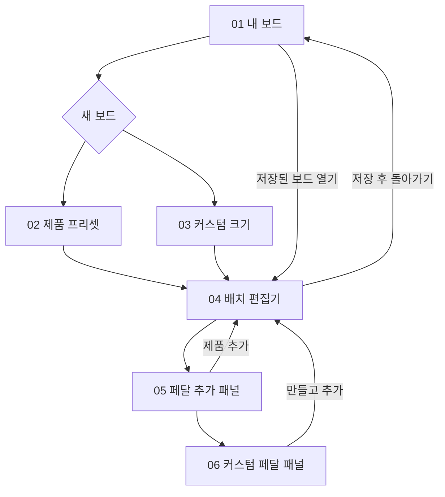

# 페달보드 테트리스 — 전체 화면 시안 v1

제작일: 2026-10-26. 내장 image_gen 도구로 생성했습니다. 기존 시안 02를 디자인 참조로 사용했습니다. 모든 생성 프롬프트는 prompts/에 있습니다.

## 범위

메인 화면은 3개입니다. 보드 생성 화면의 두 탭을 따로 보여주고 보조 패널 2개를 더해 **시안 이미지 총 6장**으로 정리했습니다.

| 번호 | 이미지 | 역할 |
|---|---|---|
| 01 | [내 보드](01_my_boards_v2.png) | 저장된 배치 미리보기, 검색, 프리셋·커스텀 필터, 새 보드 |
| 02 | [보드 생성 — 제품 프리셋](02_board_preset.png) | Pedaltrain 시리즈·모델 선택, 치수와 비율 미리보기 |
| 03 | [보드 생성 — 커스텀](03_board_custom.png) | 보드 이름, 가로·깊이, 비율 잠금, 색상 |
| 04 | [배치 편집기](04_board_editor.png) | 이동, 선택, 치수, 회전, 복제, 삭제, 스냅, 확대, 경계 이탈 |
| 05 | [페달 추가 패널](05_add_pedal.png) | 이름·크기 검색, 크기별 필터, 치수 확인과 추가 |
| 06 | [커스텀 페달 패널](06_custom_pedal.png) | 이름·본체 크기·색상·좌우 잭 여유 입력 |

`01_my_boards.png`는 최초 생성본입니다. 최종 선택본은 첫 카드 개수 표시를 8개로 바로잡은 `01_my_boards_v2.png`이며, 전달 ZIP에는 선택본만 포함했습니다.

## 주요 흐름

## 구현 시 지킬 동작

- 제품 프리셋은 확인된 19개 제품 데이터를 사용합니다. 02에는 Classic 제품 일부를 보여주며 시리즈와 목록을 스크롤하여 선택합니다.
- 제품 프리셋 Classic 2는 609.6 × 317.5 mm, 커스텀 예시는 600 × 320 mm입니다. 06은 커스텀 보드를 편집하는 상황의 예시입니다.
- 프리셋 치수를 바꾸면 커스텀으로 전환하고 원본 프리셋 ID를 보관합니다.
- 위치·본체 크기·잭 여유 공간은 mm 데이터로 분리하여 저장합니다. 좌우 여유 12 mm는 예시 입력값이며 모든 제품의 권장값으로 고정하지 않습니다.
- 크기 미리보기는 실제 앱에서 가로·깊이 비율로 그립니다. 생성 이미지 자체는 정밀 축척 도면이 아니므로 이 이미지에서 실물 적합성을 측정하지 않습니다.
- 선택 테두리의 모서리 표시는 선택 표시입니다. 드래그로 실제 페달의 크기를 임의로 늘이거나 줄이는 기능을 뜻하지 않습니다. 페달은 이동·회전만 가능하며 치수 수정은 별도 커스텀 입력에서 수행합니다.
- 보드를 바꿔도 페달 실물 크기를 유지합니다. 경계 이탈과 페달 본체 겹침, 잭 공간 충돌을 구분합니다.
- 레일 이미지는 개념 표현입니다. 레일 실제 폭·간격은 아직 검증되지 않았으므로 고정 가능 영역 판정에 그대로 쓰지 않습니다.
- 빈 보드·빈 목록·검색 결과 없음, 삭제 확인, 저장 완료 등은 해당 화면의 상태 변화로 처리합니다. 별도 전체 화면을 추가하지 않습니다.
- 삭제와 보드 변경 시 복구 동작, 저장 중 이탈 확인, 잘못된 크기 입력 검증은 구현 단계에서 포함합니다.

## 사용 범위

이미지는 디자인 검토용이며 실행되는 Flutter 화면이 아닙니다. 이번 작업에서 Flutter 코드는 수정하지 않았습니다. 가상 페달 그래픽을 사용했고 제조사 제품 사진·로고는 포함하지 않았습니다. 이미지 전체를 앱 배경으로 붙이지 않고, 구현 시 텍스트·버튼·캔버스 요소를 개별 위젯으로 만듭니다.

제품 치수 근거는 [Pedaltrain 조사 문서](../../research/pedaltrain_board_presets.md)를 참고하세요.
